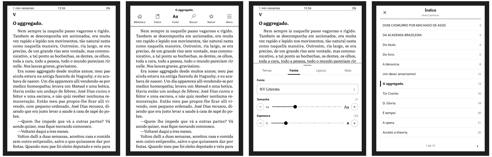
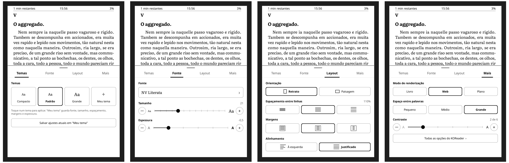
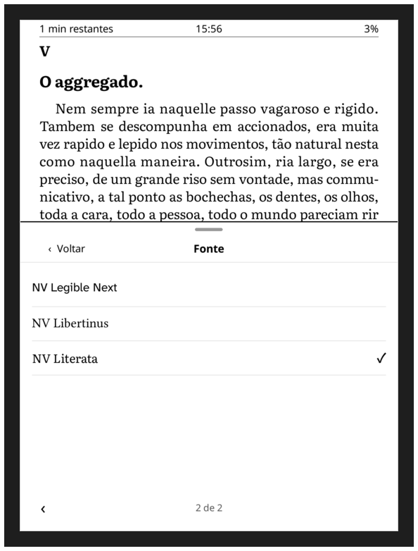
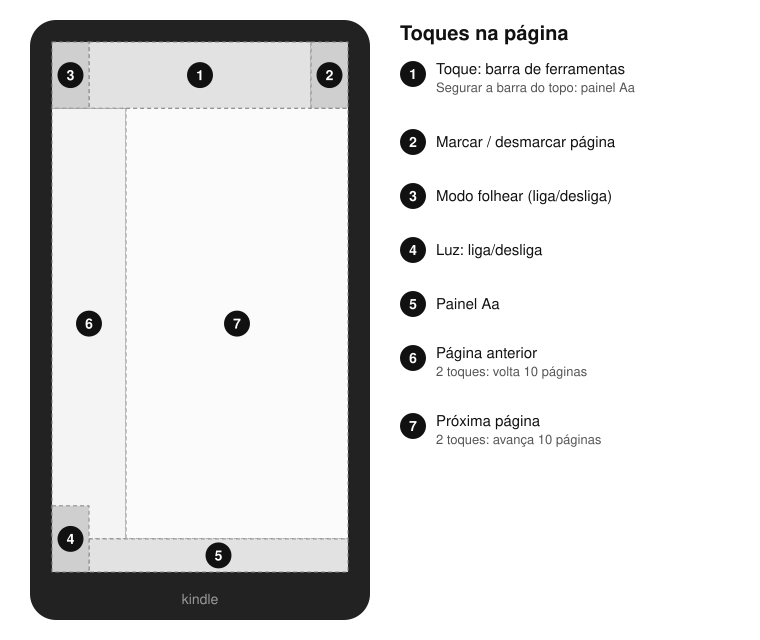
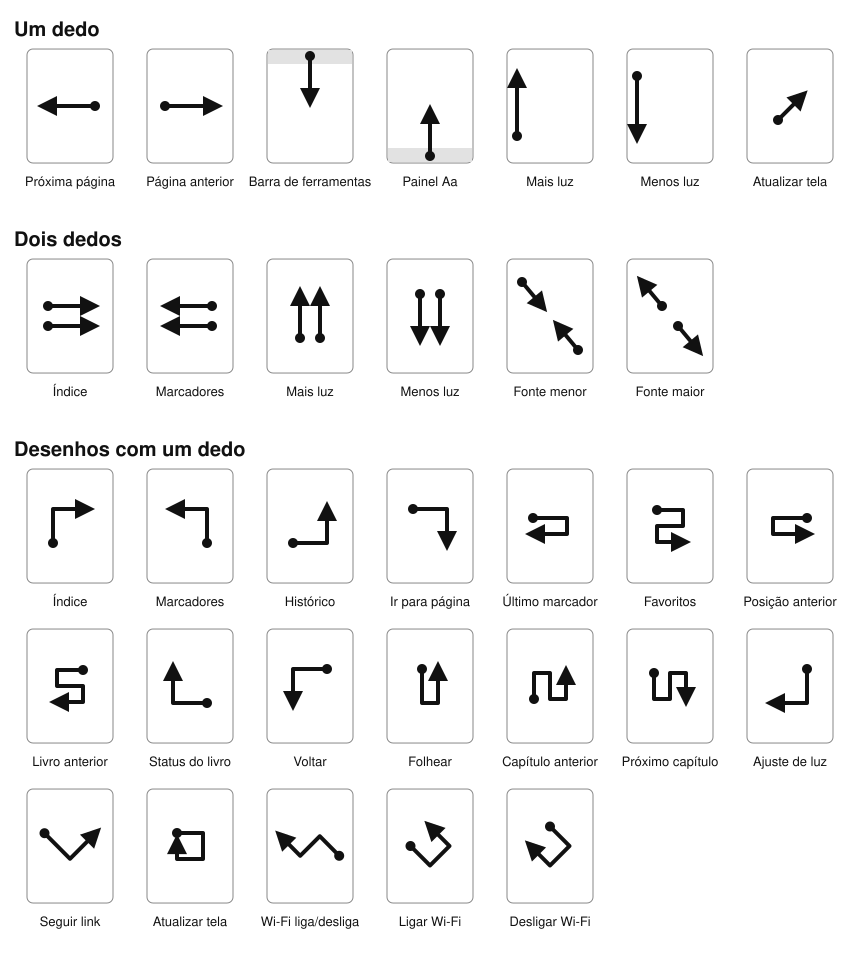

# KOReader com cara de Kindle

Patches para o [KOReader](https://github.com/koreader/koreader) que trocam a interface de leitura de EPUB
por uma mais simples, parecida com a do Kindle: barra no topo, barra de ferramentas,
painel **Aa** com abas e um **Índice** limpo. Feito e testado num Kindle Basic 2024 com KOReader 2026.07.1.



## O que muda

| | Antes (KOReader) | Agora |
|---|---|---|
| Topo da página | barra do crengine com título, bateria, marcas de capítulo | **tempo restante no capítulo · hora · % lido** |
| Toque no topo | menu completo do KOReader + painel inferior | **barra de ferramentas**: Biblioteca · Índice · Fonte · Buscar · Marcar · Menu |
| Toque embaixo | painel com 6 ícones e dezenas de opções | **painel Aa**: Temas · Fonte · Layout · Mais |
| Índice | lista do KOReader | **tela cheia**, capítulo atual em destaque, toque para ir |

Os menus completos do KOReader continuam a um toque: botão **Menu** na barra de ferramentas e
**Mais › Todas as opções do KOReader** no painel Aa. PDFs continuam com a interface padrão.

## Painel Aa



- **Temas**: Compacto, Padrão, Grande e "Meu tema" (salva fonte, tamanho, entrelinha, margens e espessura).
- **Fonte**: lista com cada fonte escrita nela mesma, tamanho (− régua +) e espessura do traço.
- **Layout**: orientação, espaçamento entre linhas, margens e alinhamento (à esquerda / justificado).
- **Mais**: modo de renderização (Livro / Web / Plano), espaço entre palavras e contraste.

As mudanças aparecem na hora, com o painel aberto, e viram o padrão para livros abertos pela primeira vez,
como no Kindle.

<p align="center">
  
  
  
</p>

## Gestos

Os toques do topo e de baixo vêm dos patches. As outras gestures são as minhas configurações do plugin
*Gestures* do KOReader ([`settings/gestures.lua`](settings/gestures.lua)) e funcionam junto com os patches.

### Toques



### Deslizar e desenhar

O ponto marca onde o dedo começa e a seta, onde termina. "Desenhos" são feitos com um dedo só, sem soltar.



### Lista completa (lendo um livro)

| Gesture | Ação |
|---|---|
| Toque no topo | Barra de ferramentas |
| Segurar a barra do topo | Painel Aa |
| Toque embaixo · deslizar ↑ a partir de baixo | Painel Aa |
| Deslizar ↓ a partir do topo | Barra de ferramentas |
| Toque no canto superior direito | Marcar / desmarcar página |
| Toque no canto superior esquerdo | Modo folhear |
| Toque no canto inferior esquerdo | Luz liga/desliga |
| Toque no lado esquerdo / direito | Página anterior / próxima |
| 2 toques no lado esquerdo / direito | Volta / avança 10 páginas |
| Deslizar ← / → | Próxima / anterior página |
| Borda esquerda ↑ / ↓ | Mais / menos luz |
| Diagonal curta | Atualizar tela (limpa fantasmas do e-ink) |
| 2 dedos → | **Índice** |
| 2 dedos ← | Marcadores |
| 2 dedos ↑ / ↓ | Mais / menos luz |
| Pinça / abrir | Fonte menor / maior |
| ↑ → | **Índice** |
| ↑ ← | Marcadores |
| → ↑ | Histórico |
| → ↓ | Ir para página |
| → ← | Último marcador |
| → ← → | Favoritos |
| ← → | Voltar à posição anterior |
| ← → ← | Abrir livro anterior |
| ← ↑ | Status do livro |
| ← ↓ | Voltar |
| ↓ ↑ | Folhear |
| ↑ ↓ ↑ | Capítulo anterior |
| ↓ ↑ ↓ | Próximo capítulo |
| ↓ ← | Ajuste de luz |
| ↘ ↗ | Seguir o link mais próximo |
| → ↓ ← ↑ | Atualizar tela |
| ↖ ↙ ↖ | Wi-Fi liga/desliga |
| ↘ ↗ ↖ / ↘ ↙ ↖ | Ligar / desligar Wi-Fi |
| ↓ → · → ↑ ← · → ↑ ← → · ↓ → ↑ · ↓ → ↑ ↓ | Só em PDF: reflow e modos de zoom |

Todo jeito de abrir o índice (botão **Índice**, gestures ou Menu › Table of contents) mostra o Índice simples.
Dentro do Índice e da lista de fontes, deslize ← / → para trocar de página. Painéis fecham com toque fora ou deslizando ↓.

## Instalação

1. Copie os arquivos de `patches/` para `koreader/patches/` no Kindle.
2. (Opcional) Instale as fontes indicadas em [`fonts/README.md`](fonts/README.md) em `koreader/fonts/`.
3. (Opcional) Para usar as mesmas gestures, copie `settings/gestures.lua` para `koreader/settings/` com o KOReader fechado.
4. Reinicie o KOReader. Patches só são carregados quando ele abre.

Para desfazer, apague os patches e reinicie.

> O nome do patch precisa começar com `2-`. O KOReader reserva os prefixos `3-` a `7-` e **não executa** esses arquivos.

## Conteúdo do repositório

| Caminho | O que é |
|---|---|
| `patches/2-kindle-header.lua` | barra do topo (reserva espaço na margem, relógio atualiza a cada minuto) |
| `patches/2-kindle-ui.lua` | barra de ferramentas, painel Aa e Índice |
| `settings/design-settings.lua` | minhas configurações de visual (fonte, margens, rodapé, protetor de tela) para referência |
| `settings/gestures.lua` | minhas gestures (vai em `koreader/settings/gestures.lua`) |
| `tools/gen_gestures.py` | gera os diagramas de gestures em `docs/gestures/` |
| `fonts/` | quais fontes uso e onde baixar |
| `mockups/` | esboços feitos antes da implementação |
| `tools/kmtp.c` | cliente MTP de sessão única para o Kindle no macOS (o Kindle desconecta após cada sessão do libmtp) |
| `tools/emu/` | emulador do KOReader em Docker com a tela do Kindle (1072×1448, 300 dpi), usado para gerar as imagens |

### kmtp (macOS)

```sh
brew install libmtp
cc -O2 -o tools/kmtp tools/kmtp.c $(pkg-config --cflags --libs libmtp)
printf 'ls\tkoreader/patches\nquit\n' | tools/kmtp
```

Comandos separados por TAB: `ls`, `tree`, `get <caminho> <local>`, `rm <caminho>`, `put <local> <pasta>` (falha se já existe), `quit`.

## Créditos e licença

- [KOReader](https://github.com/koreader/koreader) (AGPL-3.0). Os patches usam a API interna dele.
- Imagens geradas no emulador com *Dom Casmurro*, de Machado de Assis (domínio público, [Projeto Gutenberg](https://www.gutenberg.org/ebooks/55752)).
- Licença: [AGPL-3.0](LICENSE), a mesma do KOReader.
